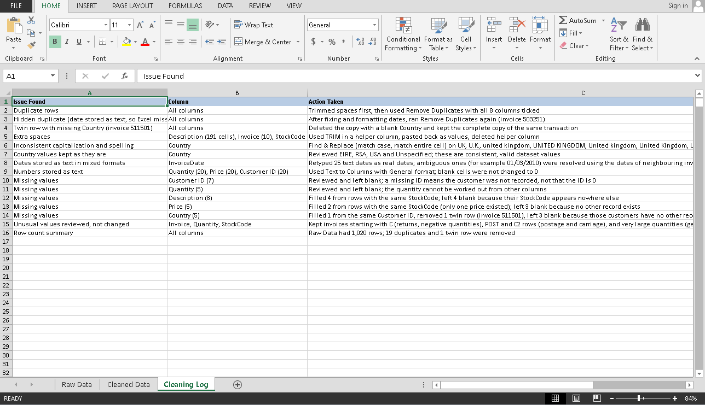
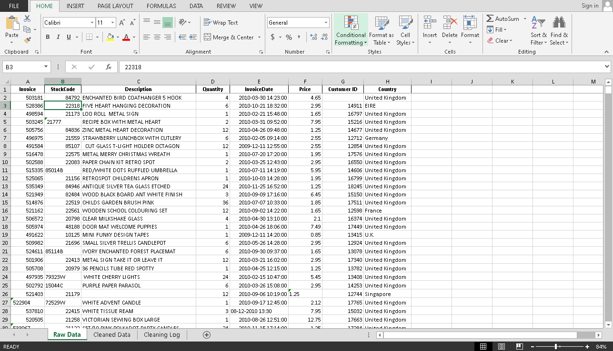
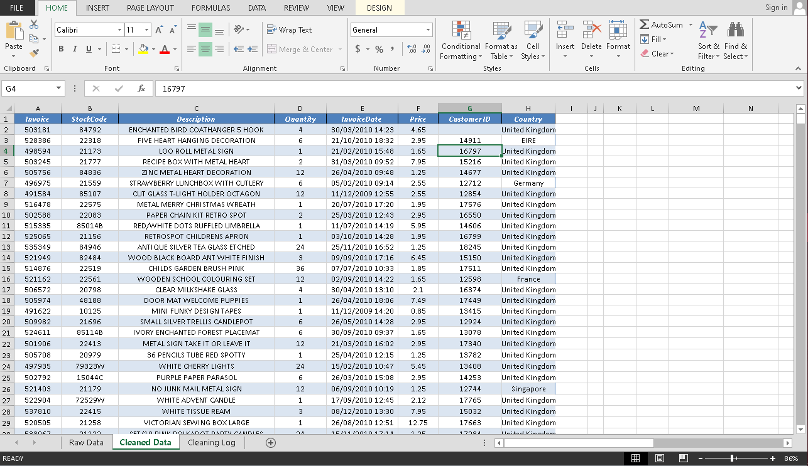

# Retail Data Cleaning in Excel

**TechBridge Data Analytics Internship, Task 1**

Author: Emmanuel Oyediji (OyeeAnalytics), data analyst
GitHub: [EmmanuelOyediji](https://github.com/EmmanuelOyediji)

---

## Overview

For Task 1 of the TechBridge Data Analytics Internship, I was given a messy retail transaction dataset and asked to clean it. My goal was to fix the real problems in the data, document every decision I made, and leave the original data untouched so every change can be traced back.

I cleaned the data in Microsoft Excel, then converted the workbook to Google Sheets for submission.

## Dataset

- 1,020 rows and 8 columns
- Columns: Invoice, StockCode, Description, Quantity, InvoiceDate, Price, Customer ID, Country
- Retail transactions from December 2009 to December 2010
- Provided by TechBridge

## Tools

- Microsoft Excel: TRIM, Remove Duplicates, Find & Replace, Text to Columns, custom date formats, COUNTBLANK and COUNTIF checks
- Google Sheets (for submission)

## Workbook Structure

1. **Raw Data**: the original dataset, unchanged
2. **Cleaned Data**: 1,000 rows after cleaning
3. **Cleaning Log**: 15 documented actions



## Problems and Fixes

| Problem | How much | How I fixed it |
|---|---|---|
| Extra spaces | Description 191 cells, Invoice 10, StockCode 10 | Used TRIM in a helper column and pasted the results back as values. I did this before removing duplicates because stray spaces can hide duplicates. |
| Exact duplicate rows | 18 rows | Used Remove Duplicates with all 8 columns ticked, since only full-row matches count as duplicates. |
| Hidden duplicate | 1 row (invoice 503251) | Excel missed it because one date was stored as text and the other was displayed in a different layout. I found it after fixing the dates, which brought the total to 19 duplicates. |
| Twin row | 1 row (invoice 511501) | The invoice appeared twice, once with a blank Country. I removed the incomplete copy and kept the complete one. |
| Inconsistent country names | UK variants plus germany, FRANCE, eire | Standardized with Find & Replace using Match case and Match entire cell contents. UK variants were UK, U.K., united kingdom, UNITED KINGDOM, United kingdom, United KIngdom and Un ited Kingdom. |
| Dates stored as text | 25 InvoiceDate values | Converted them to real date and time values and formatted everything as dd/mm/yyyy hh:mm. Mixed formats included 2010-06-21, 08-12-2010, 11/02/2010, 05/16/2010 and 31/03/2010. |
| Numbers stored as text | Quantity 20, Price 20, Customer ID 20 | Converted with Text to Columns (General), keeping blanks as blanks. |
| Missing Customer ID | 7 cells | Left blank. The customer was not recorded. |
| Missing Quantity | 5 cells | Left blank. It cannot be inferred. |
| Missing Description | 8 cells | Filled 4 from other rows with the same StockCode. Left 4 blank because the code appears nowhere else. |
| Missing Price | 5 cells | Filled 2 from rows with the same StockCode, where only one price existed. Left 3 blank. |
| Missing Country | 5 cells | Filled 1 from the same Customer ID, removed 1 as the twin row, left 3 blank. |

## Key Decisions

- **The original stays untouched.** All changes were made in a separate sheet, and every action is recorded in the Cleaning Log.
- **TRIM before duplicates.** Stray spaces make identical rows look different, so I cleaned spaces first.
- **Only full-row matches count as duplicates.** I ticked all 8 columns in Remove Duplicates.
- **A blank is not a zero.** I never replaced missing values with 0. I filled a value only when another row gave me solid evidence, and otherwise left the cell blank and documented it.
- **Unusual values were reviewed and kept.** Credit notes (invoices starting with C, with negative quantities), POST and C2 rows (postage and carriage) and very large quantities (bulk orders) are real transactions. EIRE, RSA, USA and Unspecified are valid country values in this dataset, so I left them.
- **Ambiguous dates were resolved with evidence.** For dates like 01/03/2010, I checked the dates of neighbouring invoice numbers, since invoices run in date order.

## Results

**Before and after**

- Rows in: 1,020
- Rows out: 1,000
- Rows removed: 20 (19 duplicates and 1 twin row), each one justified in the log
- Every date is now a real date in one format
- Quantity, Price and Customer ID are all numeric
- Country names are consistent




## Verification Checks I Ran

- Counted blanks in every column with COUNTBLANK, so the missing values in the log match the sheet
- Compared a COUNTIF count (901) against an EXACT-based count (884) to catch Country values still in the wrong capitalization
- Re-checked for duplicates after converting the dates
- Confirmed Quantity, Price and Customer ID are numeric
- Confirmed the final row count is 1,000 (1,020 minus 20 removed)

## What I Learned

- **Order matters.** Cleaning spaces and fixing dates before removing duplicates found duplicates that Excel would have missed on a first pass.
- **Remove Duplicates can mislead.** With "Expand the selection," it can stretch across a million empty rows and report a huge false count. Selecting the exact data range first avoids this.
- **Find & Replace is not case-sensitive by default.** Without Match case, the wrong capitalization stays behind. Comparing COUNTIF against EXACT (901 vs 884) exposed it.
- **Text format is stubborn.** Cells stuck in Text format keep converting typed dates back to text. The fix is to Clear All, set the format, then retype.
- **Display is not value.** Two dates that show different layouts can block duplicate detection even when the underlying value is identical.
- **Missing data should be documented, not invented.** A blank is not a zero, and a careful note in the log is worth more than a convenient guess.

## How to View the Project

View the live workbook here (view only):
[Open the workbook in Google Sheets](https://docs.google.com/spreadsheets/d/13uRXylv-C9fkihAm-794qyiQx5-lLUyO5xyckDtxZtA/edit?usp=sharing)

## Repository Contents

```
README.md
EmmanuelOyediji_Task1_Data_Cleaning.xlsx
screenshots/
    (raw vs cleaned comparison, Cleaning Log)
```

## Author

**Emmanuel Oyediji (OyeeAnalytics)**
Data analyst working with Excel, SQL and Power BI
GitHub: [github.com/EmmanuelOyediji](https://github.com/EmmanuelOyediji)
